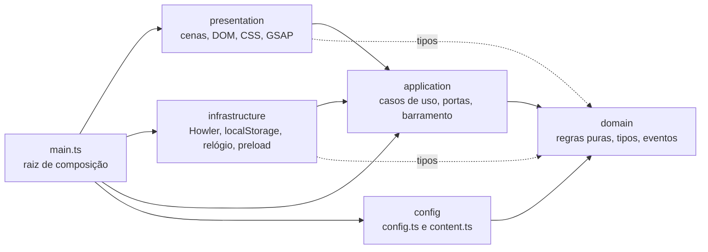

# Arquitetura

O convite é um **monolito de página única** (Vite, TypeScript, GSAP), organizado em **clean architecture**:
as regras do convite não conhecem o navegador, e o navegador é plugado por fora.
A decisão e as trocas em relação à documentação original estão em
[ADR-0001](./decisions/0001-typescript-e-clean-architecture.md).

## Camadas e regra de dependência



| Camada           | Pasta                 | Pode importar                        | Não pode                                            |
| ---------------- | --------------------- | ------------------------------------ | --------------------------------------------------- |
| `domain`         | `src/domain/`         | só `domain`                          | DOM, GSAP, Howler, Node, qualquer outra camada      |
| `application`    | `src/application/`    | `domain`                             | DOM, GSAP, Howler, `infrastructure`, `presentation` |
| `config`         | `src/config/`         | `domain` (só tipos)                  | comportamento, qualquer outra camada                |
| `infrastructure` | `src/infrastructure/` | `application`, `domain`, pacotes npm | `presentation`                                      |
| `presentation`   | `src/presentation/`   | `application`, `domain`, GSAP        | `infrastructure` (recebe as portas pelo `ctx`)      |
| raiz             | `src/main.ts`         | tudo                                 | ser importada por qualquer camada                   |

As regras são executáveis: `.dependency-cruiser.cjs` (`pnpm arch`) e
`tests/architecture/` (`pnpm test:arch`, que também prova, com fixtures, que cada regra dispara).
O ESLint reforça no editor: `domain` e `application` não podem usar `window`, `document`,
`localStorage`, `Date.now()` etc.

## Estrutura de pastas

```text
src/
├── main.ts                      # raiz de composição: instancia adaptadores e liga tudo
├── config/
│   ├── config.ts                # datas, links, durações, curvas, volumes (SPEC-01)
│   └── content.ts               # todos os textos visíveis (SPEC-01, RNF-01.2)
├── domain/                      # regras puras, sem I/O, determinísticas
│   ├── config/                  # tipo ConfigConvite
│   ├── acessibilidade/          # razão de contraste WCAG (SPEC-09)
│   ├── conteudo/                # tipo ConteudoConvite
│   ├── contagem/                # estado por data, contagem regressiva, plural (SPEC-07)
│   ├── eventos/                 # EventosConvite: nomes e dados do barramento (SPEC-01)
│   ├── fase/                    # fases do orquestrador (SPEC-01)
│   ├── historia/                # posições verticais dos balões, com limite em telas baixas (SPEC-05)
│   ├── profundidade/            # deslocamento por ponteiro (SPEC-03)
│   ├── imagens/                 # catálogo: críticas, fila secundária, arte por orientação (SPEC-02)
│   ├── tela/                    # orientação (vertical, horizontal)
│   └── tempo/                   # fuso de Brasília, minutos, instantes, data por extenso
├── application/
│   ├── ports/                   # interfaces: Relogio, Preferencias, Ambiente, AudioPort, (PreloadPort…)
│   ├── use-cases/               # obter-informacoes, orquestrador, audio-do-convite, carregamento
│   ├── barramento-eventos.ts    # on / off / emit tipados (SPEC-01, RF-01.7)
│   ├── cena.ts                  # contrato Cena { init, run, skip, destroy } (RF-01.6)
│   └── estado-convite.ts        # fase, som, visita, movimento, orientação (RF-01.8)
├── infrastructure/              # adaptadores das portas
│   ├── ambiente/                # matchMedia (animação reduzida, toque, orientação) e visibilidade da página
│   ├── audio/                   # AudioPort com Howler.js (SPEC-08)
│   ├── imagens/                 # download e decodificação de imagens (SPEC-02)
│   ├── tempo/                   # Temporizador real
│   ├── desenvolvimento/         # ?erro= (só em DEV)
│   ├── erros/                   # window.error e unhandledrejection → modo de segurança
│   ├── relogio/                 # relógio real e data simulada (?data=)
│   └── armazenamento/           # preferências em localStorage, à prova de falha
├── presentation/                # tudo que desenha: cenas, componentes, GSAP
│   ├── audio/                   # botão de som (SPEC-08)
│   ├── acessibilidade/          # atalho "Ir direto ao convite" (SPEC-09)
│   ├── bau/                     # baú, chave, dica e abertura (SPEC-04)
│   ├── carta/                   # envelope, selo, carta e abertura em 7 s (SPEC-06)
│   ├── historia/                # balões, frases, aceleração e tlHistoria (SPEC-05)
│   ├── petalas/                 # função de pétalas, compartilhada com a SPEC-06
│   ├── bosque/                  # cena do bosque: camadas, revelação e profundidade (SPEC-03)
│   ├── entrada/                 # névoa, nomes e "Toque para entrar" (SPEC-02)
│   └── informacoes/             # cartões de contagem e botões (SPEC-07)
└── styles/                      # tokens.css (única fonte de cores/fontes/camadas), base.css, …
tests/
├── integration/                 # camadas reais conectadas, DOM simulado (happy-dom)
└── architecture/                # regras de dependência + fixtures que as violam
scripts/                         # gates de publicação (verificar.ts) — leem o src, nunca o contrário
docs/                            # documentação e contexto (ver docs/README.md)
```

## Onde cada spec vai morar

| Spec / peça                                           | Camada                                                                                          | Observação                                                                                                             |
| ----------------------------------------------------- | ----------------------------------------------------------------------------------------------- | ---------------------------------------------------------------------------------------------------------------------- |
| SPEC-01 estados, eventos, fases                       | `domain`                                                                                        | feito: `fase`, `eventos`                                                                                               |
| SPEC-01 barramento                                    | `application`                                                                                   | feito: `barramento-eventos.ts`                                                                                         |
| SPEC-01 orquestrador (`iniciar`, `pular`, `falhar`)   | `application/use-cases`                                                                         | feito: recebe um `PlanoDoConvite` de cenas `Cena`; sem DOM (ADR-0004)                                                  |
| SPEC-01 contrato da cena `{init, run, skip, destroy}` | `application`                                                                                   | feito: `cena.ts`; implementações em `presentation/` (o `ctx` vai à fábrica)                                            |
| SPEC-01 `state`                                       | `application`                                                                                   | feito: `estado-convite.ts` + portas `Preferencias` e `Ambiente`                                                        |
| SPEC-02 `preload`                                     | portas `CarregadorDeImagens` e `Temporizador` em `application`, adaptadores em `infrastructure` | feito: `use-cases/carregamento.ts`; `img.decode()` no adaptador (ADR-0006)                                             |
| SPEC-03 bosque                                        | `presentation/bosque`                                                                           | feito: `cena-bosque.ts` (camadas, revelação) e `profundidade.ts` (mouse/deriva); a matemática em `domain/profundidade` |
| SPEC-04 baú e chave                                   | `presentation/bau`                                                                              | feito: `cena-bau.ts` (cursor ou chave flutuante, dica, reforço, `tlBau`) e `petalas/soltar-petalas.ts`                 |
| SPEC-05 história em balões                            | `presentation/historia`                                                                         | feito: `cena-historia.ts` (`tlHistoria` com `tlLuz`, aceleração 3×, região `aria-live`); posições em `domain/historia` |
| SPEC-06 carta e convite                               | `presentation/carta`                                                                            | feito: `cena-carta.ts` (duas etapas, um DOM), `montar-carta.ts` (14 blocos), `petalas/chuva-de-petalas.ts` (ADR-0007)  |
| SPEC-02 cenas e GSAP                                  | `presentation/scenes/`                                                                          | cada cena recebe `ctx = { root, content, config, state, events, audio }`                                               |
| SPEC-04 cursor de chave                               | `presentation`                                                                                  | detecção de `pointer` via porta ou `matchMedia` no adaptador                                                           |
| SPEC-07 contagem e estados                            | `domain` + `application` + `presentation`                                                       | feito: contagem, mensagem, traje e ações; os cartões surgem ao rolar e rolam sob a carta                               |
| SPEC-08 áudio                                         | porta `AudioPort` em `application`, Howler em `infrastructure/audio`                            | feito: `conectarAudio` liga os eventos à porta; botão de som em `presentation/audio` (ADR-0005)                        |
| SPEC-09 modo de segurança                             | caso de uso em `application`; DOM em `presentation`                                             | feito: `skip()` em tudo e depois o aviso `seguranca`; atalho de teclado; `<noscript>` gerado (ADR-0008)                |
| SPEC-10 metadados e ícones                            | `index.html`, `public/`                                                                         |                                                                                                                        |
| SPEC-12 `verificar`                                   | `scripts/`                                                                                      | regras puras testadas; peso no `size-limit`                                                                            |

## Convenções

- **Idioma:** identificadores, comentários e mensagens em **português** (RNF-01.3); nomes de pasta de
  camada e de arquivo em inglês/kebab-case, como a documentação original. Ex.: `calcularContagem` em
  `domain/contagem/contagem-regressiva.ts`.
- **Imports:** dentro da mesma camada, caminho relativo; entre camadas, alias `@/` (`@/domain/tempo/tempo`).
  Ordem automática (`simple-import-sort`).
- **Injeção:** nada de singletons escondidos. Casos de uso são fábricas
  (`criarObterInformacoes({ relogio, config, conteudo })`) que devolvem funções; a raiz de composição
  escolhe os adaptadores.
- **Texto, tempo, cor:** nenhum texto, duração, link ou cor no código das cenas. Texto em `content.ts`,
  tempo/link em `config.ts`, cor e camada em `styles/tokens.css` (o Stylelint barra hex, `rgb()` e
  `z-index` numérico fora dos tokens).
- **TypeScript estrito:** `strict`, `noUncheckedIndexedAccess`, `exactOptionalPropertyTypes`,
  `erasableSyntaxOnly` (sem `enum`), `verbatimModuleSyntax` (`import type`).
- **Testes:** unidade ao lado do código (`x.ts` → `x.test.ts`); integração em `tests/integration/`;
  arquitetura em `tests/architecture/`. Detalhes em [qualidade.md](./qualidade.md).

## Receitas

**Nova regra de negócio** — função pura em `src/domain/<assunto>/`, teste ao lado, 95% de cobertura mínima.

**Novo caso de uso** — fábrica em `src/application/use-cases/` que recebe portas e devolve função;
teste com portas falsas (objetos literais), sem DOM.

**Nova porta** — interface em `src/application/ports/`; adaptador em `src/infrastructure/<assunto>/`
com teste de unidade; ligação em `src/main.ts`. Uma porta que ninguém usa ainda não entra (o
`sem-orfaos` avisa).

**Nova cena** — módulo em `src/presentation/scenes/` seguindo o contrato `Cena` da SPEC-01; textos em
`content.ts`; durações em `config.duracoes`; CSS com os tokens; teste de integração em `tests/integration/`.

**Nova regra de arquitetura** — editar `.dependency-cruiser.cjs`, adicionar o caso de violação em
`tests/architecture/fixtures/` e a asserção em `camadas.test.ts`.
